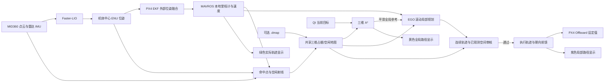
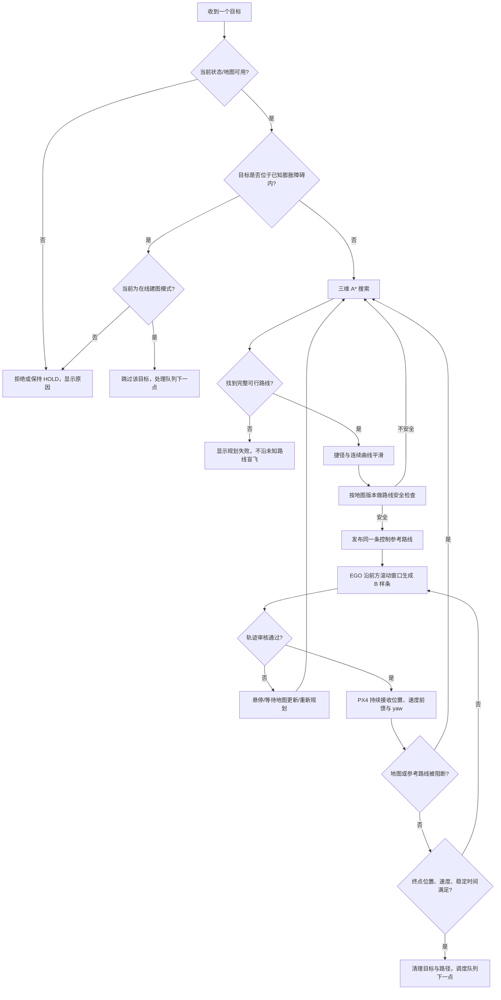

# 运行时导航与规划流程

图示对应当前点到点与多目标队列执行。地图可在线增长，也可在会话开始时载入 `.dmap`；两种模式使用同一套在线观测更新和规划管线。

## 数据流

## 目标到轨迹的运行步骤

## 路线颜色与含义

| 颜色 | 数据来源 | 语义 |
|---|---|---|
| 黄色 | 三维 A* 输出的平滑参考路线 | 当前全局规划结果；地图变化或路线失效时可更新 |
| 紫色 | 经审核并准许执行的 EGO B 样条 | 当前实际用于控制的局部轨迹，不是单独生成的显示线 |
| 绿色 | PX4/MAVROS 实际位置历史 | 已飞行轨迹 |
| 红色 | Qt 目标和机头方向标记 | 当前导航目标及机体当前方向 |

黄色路线在未知区可作为待观测参考显示，但实际执行仍要求前方空间得到观测并通过占据/空闲检查。局部路径的紫色只显示经过审核的轨迹。机器人位置沿真实路径弧长跟踪，以防急弯或交叉路径使进度跳跃。

## 规划触发与终点

- 无目标时不运行全局搜索。
- 当前完整路线仍安全时复用路线；新增障碍切断路线、目标变化、地图会话/高度边界变化等情况触发重规划。
- EGO 以约 5 m 弧长窗口滚动优化，参考点保留全局曲线形状，局部优化同时考虑平滑、障碍和路线贴合。
- EGO 输出经轨迹审核器检查。审核器检查连续曲线和前方已观测空间；失败时保持安全状态，不把黄色显示线当成可飞许可。
- 飞行管理器约 30 Hz 持续发送 Offboard 设定值。机头 yaw 根据批准执行曲线的水平有向切线调整，受到转速上限和飞控跟踪延迟影响，不能声称每一时刻严格切线对齐。
- 接近最终目标后减速，要求位置、速度与稳定时间均满足到达条件，再清除目标/路径并处理队列下一点。

搜索步长、EGO 权重、碰撞审核和健康保护的当前配置见 [详细系统架构](ARCHITECTURE.md)。图示是源码架构说明，不是一次特定实验的轨迹截图。
